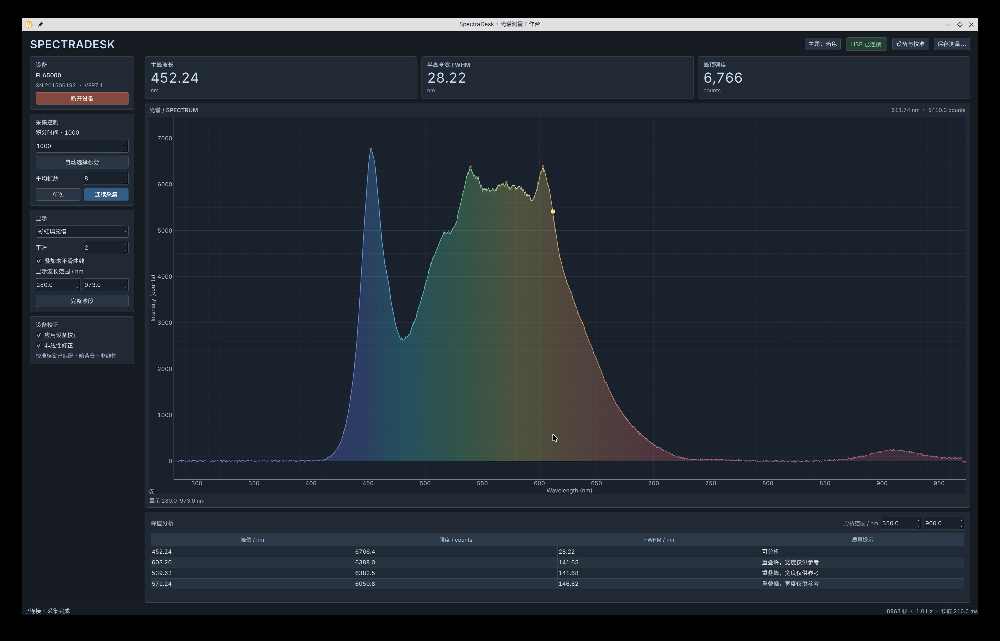

# SpectraDesk

一个 Linux 上的光谱采集软件，最开始是为了让手里的 FLIGHT FLA5000 不用开 Windows 也能工作，现在也接入了用摄像头搭建的光谱仪。

两台设备可以同时采集，各自调整曝光、平均帧数和显示方式。除了单独看，也可以把光谱叠在一起，或者上下放着比较；上下图的缩放和平移会同步，方便盯住同一段波长。



## 能做什么

- 实时采集、找峰、测半高宽和峰面积。图上有游标和峰位标记，也能切换彩虹线、填充谱和荧光余辉。
- 用三原色灯和 FLA5000 给摄像头光谱仪做参考校准，支持自动找峰配对，也可以手工输入已知谱线，留着以后用钠灯等光源标定。
- 摄像头页可以显示一条原始光带，和下面的谱峰按波长对应起来。曝光支持手动设置，也有按光带亮度调节的防饱和自动曝光。
- 对比时可以临时做峰对齐或底部对齐，方便观察差异。这些只改变显示，不改原始测量和校准。
- 测量可以保存成 NPZ 或 CSV。两台都有测量时，一次保存两份带设备名的文件。
- 默认使用 OpenGL 绘图，单设备、叠加和上下显示共用绘图控件。主题跟随系统，也可以手动选浅色或暗色。

摄像头的颜色响应和 FLA5000 不一样，波长校准后也不能直接把两台的峰高当成同一种物理量。相机目前的实测支持和内置档案针对手里这台 Theremino 3.1 卖家设备，换设备后需要重新检查和标定。

## 运行

需要 Python 3.12+、[uv](https://docs.astral.sh/uv/)、C 编译器、pkg-config 和 libusb-1.0 开发包。

```sh
git clone git@github.com:chopin1998/spectradesk.git
cd spectradesk
uv sync --locked
./run.sh
```

程序会尝试连接设备，但不会自动开始采样。设备如果被虚拟机占着，需要先释放 USB。

没有设备也可以看看界面：

```sh
./run.sh --demo
```

显卡或驱动不兼容时，用 `./run.sh --renderer raster` 切换到软件绘图。

程序会记住参数和窗口状态，并限制为单实例运行。

更多细节放在 [摄像头与校准说明](docs/CAMERA.md)、[峰面积说明](docs/PEAK_AREA.md) 和 [USB 协议文档](docs/USB_PROTOCOL.md) 里。

顺便吐槽一句：硬件都买了，想换个系统读自己的测量数据，还得自己折腾 USB 协议，实在没必要。希望厂家把协议和数据格式公开清楚，别让用户把时间花在这些本来就不该有的门槛上。
